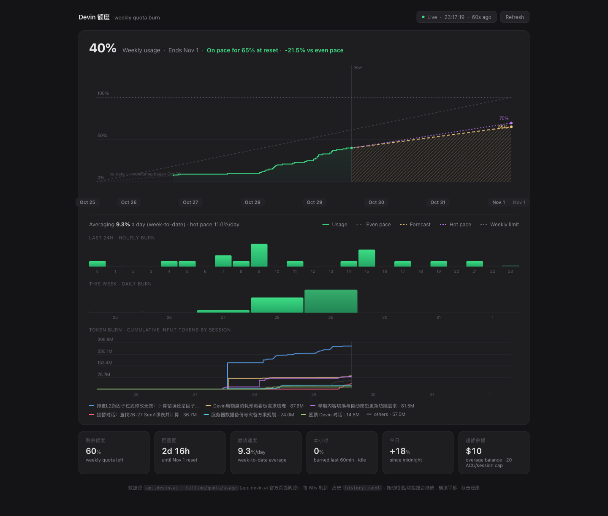

# devin-quota


A local, **read-only** weekly-quota dashboard for [Devin](https://devin.ai) —
OpenCode-style burn chart, pace-vs-forecast bands, hourly/daily burn bars,
and per-session token burn. Pure stdlib Python, single-file HTML/JS frontend,
zero dependencies.

<picture>
  <source media="(prefers-color-scheme: dark)" srcset="docs/quota-dark.png">
  <source media="(prefers-color-scheme: light)" srcset="docs/quota-light.png">
  
</picture>

The dashboard itself follows your system appearance — light by day, dark by
night (`prefers-color-scheme`).

## Features

- **Weekly burn chart** — measured usage as a step line built only from real
  poll samples; periods with no data are drawn as an explicit `no data` gap,
  never back-filled
- **Two forecast lines** — `Forecast` (amber) extrapolates the week-to-date
  average rate; `Hot pace` (purple) extrapolates the measured slope of your
  collected sample window. Together they bound "steady pace" vs "recent
  momentum"
- **Even pace reference** — the 0%→100% diagonal; above it you're burning
  faster than even, below it slower
- **Hourly & daily burn bars** — last-24h hourly and this-week daily
  consumption, differenced from cumulative samples; gaps are shown as
  no-data, future buckets stay empty
- **Token burn per session** — cumulative input-context tokens grouped by
  session, read from the local Devin session DB
- **Interactive** — hover crosshair + tooltip, drag-select or pinch/trackpad
  zoom, horizontal pan, double-click reset
- **Stat cards** — quota left, reset countdown, burn rate, this hour, today,
  overage balance + ACU/session cap
- **Freshness indicator** — header shows the age of the last good sample;
  failed polls are skipped and retried
- **Background scheduler** — polls every 60 s while the dashboard was
  recently open, 5 min otherwise; keeps collecting with the tab closed

## Install

```bash
pip install git+https://github.com/mark-618/devin-quota.git
devin-quota serve           # → http://localhost:8377
```

Requirements: Python 3.9+ and a logged-in Devin CLI, i.e.

- `~/.local/share/devin/credentials.toml` (auth token)
- `~/.config/devin/config.json` (org id)

History lands in `~/.local/share/devin-quota/history.jsonl`
(override with `DEVIN_QUOTA_HOME`).

### From a checkout

```bash
python3 quota.py serve      # → http://localhost:8377
python3 quota.py poll       # one-shot sample → history.jsonl
```

### Keep it running (macOS launchd)

Drop a plist at `~/Library/LaunchAgents/` with `RunAtLoad` +
`KeepAlive`, pointing at `python3 -m devin_quota.server serve` (or
`quota.py serve`) — one note: set `StandardOutPath`/`StandardErrorPath`
outside `~/Desktop` (e.g. `/tmp/devin-quota-server.log`), since launchd
cannot open files under TCC-protected directories.

## How the forecast works

Same week-to-date convention as OpenCode / ccusage / session-meter tools:

- `weekly_percentage` is cumulative since reset, so
  `pct / elapsed_hours` is the true average slope of the underlying
  curve — more reliable than short-window slopes (integer-% granularity
  makes them pure noise)
- `projected_pct_at_reset = pct + rate × (reset − now)`
- `exhaust_at = now + (100 − pct) / rate` — if that lands past reset,
  you're safe for the week
- **Hot pace** uses the measured slope across your collected samples:
  it rises quickly during a burst and flattens while idle — the early
  warning line

## Data source & privacy

`GET https://api.devin.ai/{org_id}/billing/quota/usage` — the same
read-only endpoint the official `app.devin.ai/settings/usage` page calls,
using your own local CLI token. No writes, no actions against your
account; everything is stored locally in `history.jsonl`. Token-burn
stats are read from `~/.local/share/devin/sessions.db` on your machine —
nothing leaves localhost.

## License

MIT
